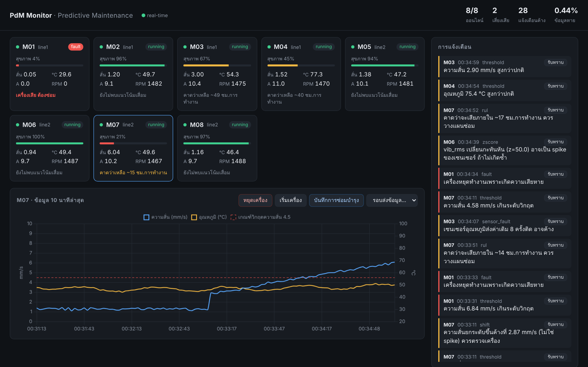
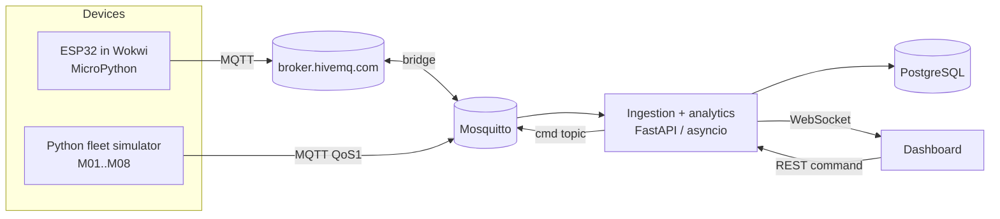

# PdM-IoT — Predictive Maintenance for Factory Machines

An end-to-end Industrial IoT system that monitors motors and pumps, detects developing faults, and estimates **Remaining Useful Life (RUL)** so maintenance can be scheduled *before* a machine breaks.

Devices → MQTT → ingestion & analytics → PostgreSQL → real-time dashboard, with two-way control back to the devices.



## Highlights

| Area | What it does |
|---|---|
| **IoT / Firmware** | ESP32 MicroPython firmware (runs in the Wokwi simulator) with on-device RMS vibration processing, MQTT Last Will, exponential-backoff reconnect, store-and-forward buffering, and a hardware watchdog |
| **Fleet simulator** | Multiple virtual machines, each its own MQTT client, with realistic physics: daily load cycles, thermal inertia, three fault modes (bearing wear, overheating, imbalance), sensor glitches, packet loss and network outages |
| **Backend** | FastAPI + asyncio MQTT ingestion, data validation, message-loss detection via sequence numbers, offline/stale-device detection, command API, WebSocket push |
| **Analytics** | Robust z-score (median/MAD), ISO 10816–style vibration thresholds, level-shift (change-point) detection, stuck-sensor detection, log-linear trend regression for RUL, alert de-duplication |
| **Dashboard** | Live machine cards with health score and RUL, trend chart, alert feed with acknowledgement, and remote commands (stop / start / maintenance / sampling interval) |

## Results (offline evaluation, reproducible)

`python analysis/evaluate_detection.py`: 300 simulated failures across 3 fault modes, plus 50 healthy machines × 500 operating hours.

| Fault mode | First warning before failure (median) | Critical alert before failure (median) |
|---|---|---|
| Bearing wear | 49 h | 23 h |
| Overheating | 26 h | 11 h |
| Imbalance | 80.5 h | 54 h |

- **300/300** failures were flagged before they happened.
- **0** false "machine is degrading" alarms on healthy machines. Sensor-glitch alerts that do fire on healthy machines are correctly labelled as sensor issues, not machine faults.

> All data is simulated. The numbers show that the detection logic behaves as designed on the simulator's fault models; they are not a claim about accuracy on real factory data.

## Architecture



**MQTT topics**

| Topic | Direction | QoS / retain |
|---|---|---|
| `factory/<line>/<id>/telemetry` | device → system | 1 |
| `factory/<line>/<id>/status` | device → system (`online`, or `offline` via Last Will) | 1, retained |
| `factory/<line>/<id>/cmd` | system → device | 1 |
| `factory/<line>/<id>/ack` | device → system | 1 |

More detail (in Thai): [docs/ARCHITECTURE.md](docs/ARCHITECTURE.md)

## Quick start

Requires Docker.

```bash
docker compose up --build
```

- Dashboard: http://localhost:8000
- API docs (Swagger): http://localhost:8000/docs

With the default settings, 1 real second equals 0.5 simulated operating hours, so the first degrading machines show up within a few minutes.

Useful knobs in `docker-compose.yml`: `MACHINE_COUNT`, `SIM_HOURS_PER_SECOND`, `FAULT_RATE`, `SEED`, and `AUTO_STOP_ON_CRITICAL` (closed-loop stop).

### Connect a simulated ESP32 (Wokwi)
▶ **Try it online:** [Open in Wokwi](https://wokwi.com/projects/481780769308684289)

See [docs/WOKWI_SETUP.md](docs/WOKWI_SETUP.md). In short: enable the Mosquitto bridge, then paste `firmware/wokwi/main.py` and `diagram.json` into a Wokwi MicroPython ESP32 project. Turn the potentiometer to raise vibration and watch the backend react.

## Project structure

```
backend/app/        FastAPI app: ingest.py, analytics.py, db.py, schema.sql, static/ (dashboard)
simulator/          machine_model.py (physics + faults), simulator.py (MQTT devices)
firmware/wokwi/     ESP32 MicroPython firmware + Wokwi wiring
analysis/           evaluate_detection.py: offline lead-time / false-alarm evaluation
mosquitto/          broker config + optional bridge to a public broker
tests/              pytest unit tests
docs/               architecture, Wokwi setup
```

## Tests

```bash
pip install -r backend/requirements.txt -r simulator/requirements.txt pytest
pytest
```

## Tech stack

Python · MicroPython · ESP32 (Wokwi) · MQTT (Mosquitto, paho-mqtt, aiomqtt) · FastAPI · asyncio · PostgreSQL (asyncpg) · WebSocket · Chart.js · Docker Compose · GitHub Actions

## Roadmap

- Real accelerometer (ADXL345/MPU6050) and FFT-based fault frequency features on the ESP32
- TimescaleDB hypertables and downsampling for long-term storage
- ML model (e.g. Isolation Forest / gradient boosting on RUL) trained on accumulated history
- MQTT authentication + TLS, per-device credentials
- OTA firmware updates


